<div align="center">


# JFLib

**A GUI library in Rust, with its own renderer, interchangeable styles, and apps built on top.**

<a href="https://jflib.org"></a>

[Features](https://jflib.org/features.html) · [Apps](https://jflib.org/apps.html) · [Developer guide](https://jflib.org/docs/GUIDE.html) · [API reference](https://jflib.org/docs/API.html) · [crates.io](https://crates.io/crates/jflib) · [Roadmap](https://jflib.org/roadmap.html) · [Source code](https://github.com/JFLibrary/JFLib)

</div>

<a href="https://jflib.org">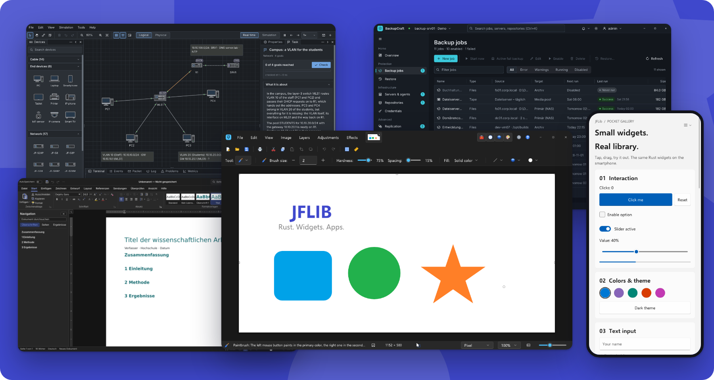</a>

JFLib brings widgets, layout, text, graphics, image formats, sound, networking, and packaging
together in one library, with no GUI framework underneath. The library uses `#![no_std]`, `core`,
and `alloc`, your app may use `std`, and Cargo builds both. The same widgets and the same renderer
run on Windows, Linux, Android, and in the browser. The
[website](https://jflib.org) starts the Feature Gallery right in your browser, with nothing to
install.

The library is designed to be used by AI agents, not by humans, so the entire code base is
optimized for hardware efficiency. An agent can build an app, run it, look at a screenshot, and
check the result by itself.

<div align="center">

**50** crates · **7** styles · **9** languages · **600+** test scripts · MIT or Apache 2.0

</div>

## Get started

You need Rust through rustup.

```sh
cargo install cargo-jflib
cargo jflib new hello
cd hello
cargo run
```

The new app is a normal Cargo project with one dependency, [`jflib`](https://crates.io/crates/jflib),
and comes with its permissions, package data, and a smoke test. `cargo jflib test` runs the test,
`cargo jflib watch` reloads the app while you edit, and `cargo jflib package` builds its installers.
The [developer guide](https://jflib.org/docs/GUIDE.html) takes it from there, the API reference is
on [docs.rs](https://docs.rs/jflib).

## What's inside

| Area | What you get |
| --- | --- |
| **Interface** | Widgets and layout, virtualized grids, trees, charts, docking panels, ribbons, a diagram canvas, a terminal, and rich-text and code editors |
| **Rendering** | Its own software renderer for text, paths, gradients, and effects, SVG images and icons, scalable interfaces, light and dark themes |
| **GPU** | An explicit GPU layer with its own WGSL compiler: Vulkan on Windows, Linux, and Android, WebGPU in the browser planned |
| **Text** | OpenType shaping, bidirectional text, font fallback, hyphenation, spell checking, and input methods |
| **Accessibility** | Screen readers through UI Automation, AT-SPI2, an ARIA tree, and Android's accessibility nodes; high contrast, a separate text scale, full keyboard operation |
| **Languages** | The library's own texts in nine languages, plural rules, regional formats, and mirrored right-to-left layouts |
| **Desktop** | Notifications, a tray icon, drag and drop with other programs, file types, global shortcuts, jump lists, and starting at login |
| **Images and documents** | Built-in codecs including PNG, JPEG, WebP, TIFF, AVIF, and JPEG XL, plus document, layout, and DOCX components |
| **Sound** | Output streams with a target latency on every platform, mixed WAV and Ogg Vorbis sounds, and the system's own sounds |
| **Files and packages** | One file namespace, a `PERMISSIONS` manifest enforced at run time, the system's secret store, signed updates with rollback, and packages from a Windows setup and `.deb` to AppImage, Flatpak, MSIX, and RPM |
| **Network and security** | HTTP, TLS 1.3, SMTP, an SSH client, DNS, modern cryptography, LZ4 and zstd, a journal database, and encrypted repositories |
| **Automation** | PNG screenshots without a visible window, `.uis` test scripts, a live inspector, hot reload, and JSON/MCP control that must be explicitly enabled |

## One interface, many styles

The style is selected at build time and is independent of the operating system. Light and dark
themes, accent colors, and scaling change at runtime, and a small INI file lays your own colors,
corners, and spacing over any style.

| WinUI | macOS style | KDE style |
| --- | --- | --- |
| 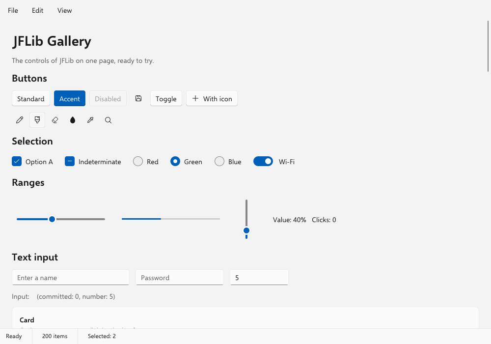 | 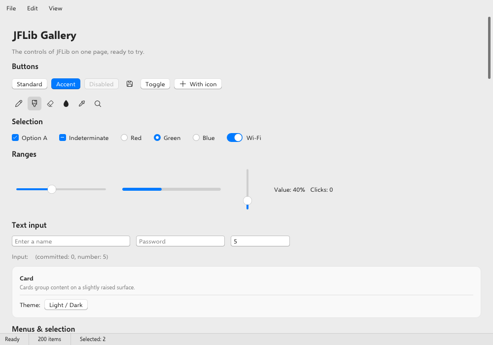 | 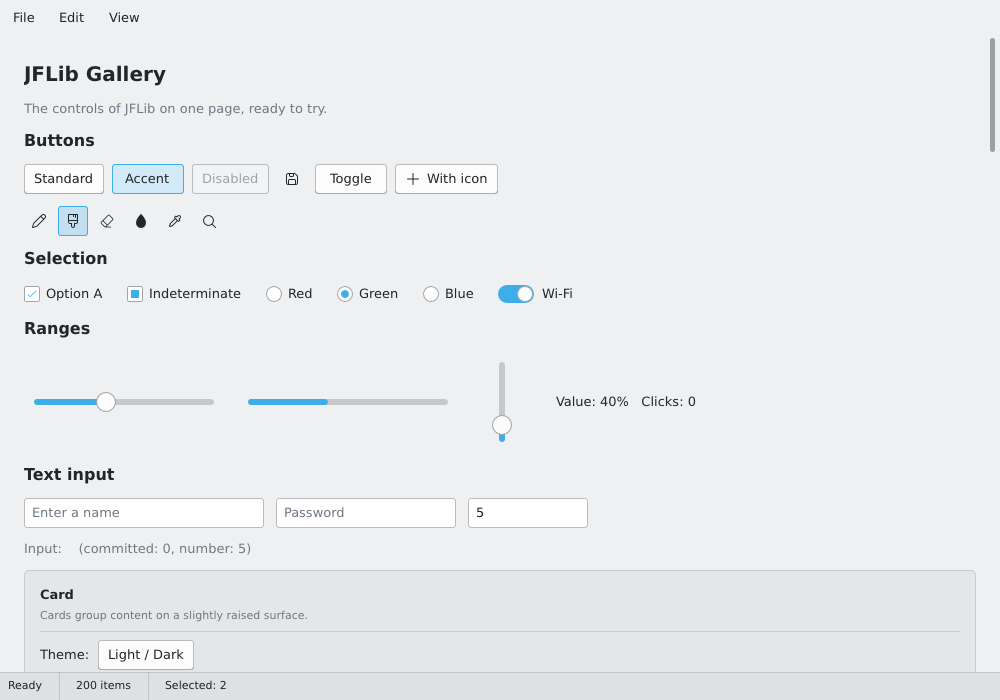 |

| Classic | jfOffice | WinUI dark |
| --- | --- | --- |
| 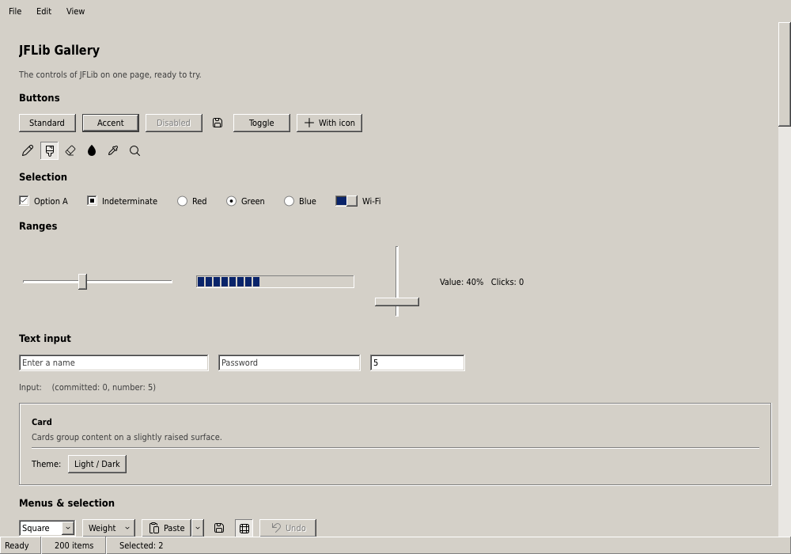 | 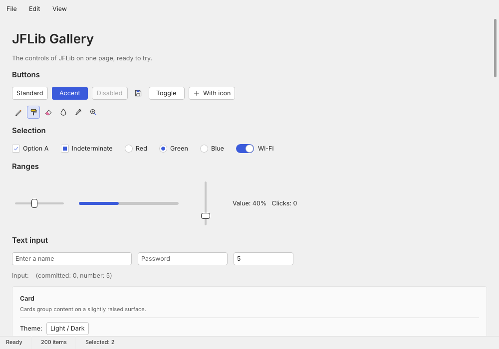 | 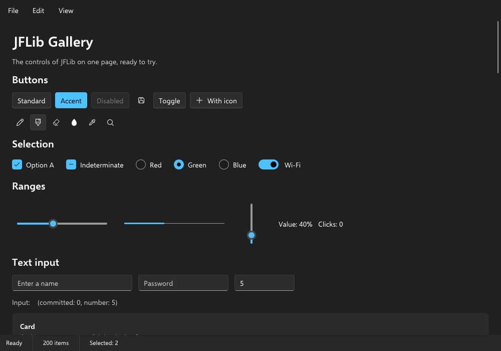 |

## Platforms

| Platform | How it runs |
| --- | --- |
| **Windows** | Native x86-64 app with desktop integration |
| **Linux** | Native x86-64 app, Wayland and X11, picked at startup |
| **Android** | Native APK for Android 8 and later, the Pocket Gallery so far |
| **Browser** | WebAssembly, tested on Chromium and Firefox |
| **macOS, iOS** | Through the browser for now, no native build yet |

## Apps built with JFLib

<table>
<tr>
<td width="50%" valign="top">
<a href="https://github.com/JFLibrary/JFNetworker">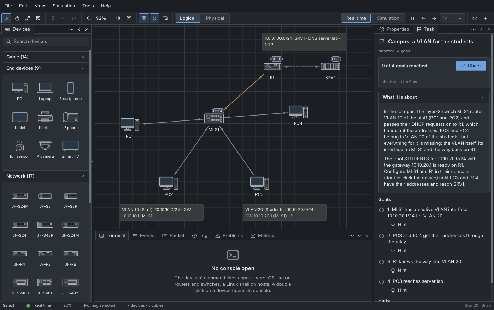</a><br>
<b><a href="https://github.com/JFLibrary/JFNetworker">JFNetworker</a></b><br>
A network simulator and lab with a topology editor, device consoles, and a step-by-step simulation mode.<br>
<sub>Windows, Linux</sub>
</td>
<td width="50%" valign="top">
<a href="https://github.com/JFLibrary/JFLib/tree/main/apps/BackupCraft">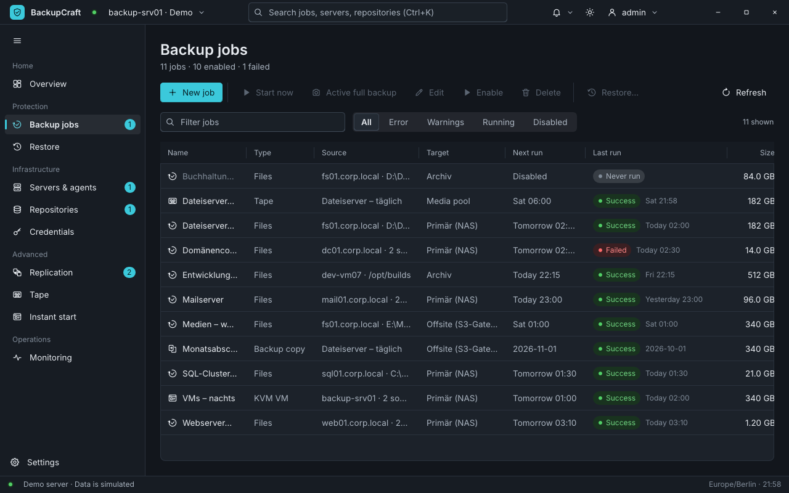</a><br>
<b><a href="https://github.com/JFLibrary/JFLib/tree/main/apps/BackupCraft">BackupCraft</a></b><br>
A backup suite with deduplicated, encrypted, signed backups, schedules and roles, and its own server and agents.<br>
<sub>Windows, Linux</sub>
</td>
</tr>
<tr>
<td width="50%" valign="top">
<a href="https://github.com/JFLibrary/JFPainter">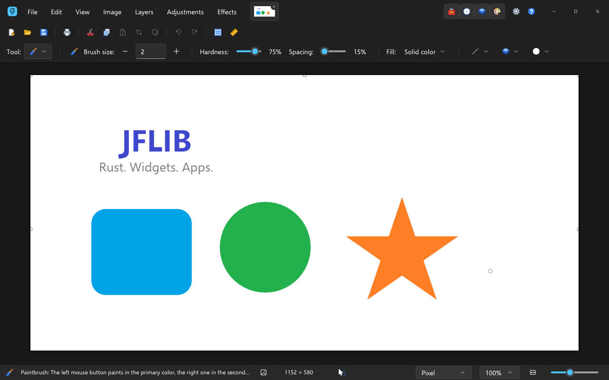</a><br>
<b><a href="https://github.com/JFLibrary/JFPainter">JFPainter</a></b><br>
An image editor with layers, history, effects, many image formats, and native plugins, built from the crate on crates.io.<br>
<sub>Windows, Linux, Web</sub>
</td>
<td width="50%" valign="top">
<a href="https://github.com/JFLibrary/JFLib/tree/main/apps/jfWord">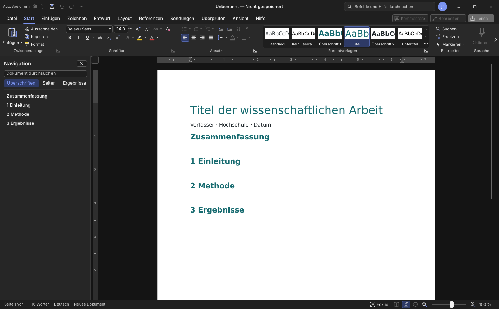</a><br>
<b><a href="https://github.com/JFLibrary/JFLib/tree/main/apps/jfWord">jfWord</a></b><br>
A word processor with a ribbon, page view, text styles, tables, references, and DOCX support. Under active development.<br>
<sub>Windows, Linux, Web</sub>
</td>
</tr>
<tr>
<td width="50%" valign="top">
<a href="https://github.com/JFLibrary/JFLib/tree/main/apps/Kritzel">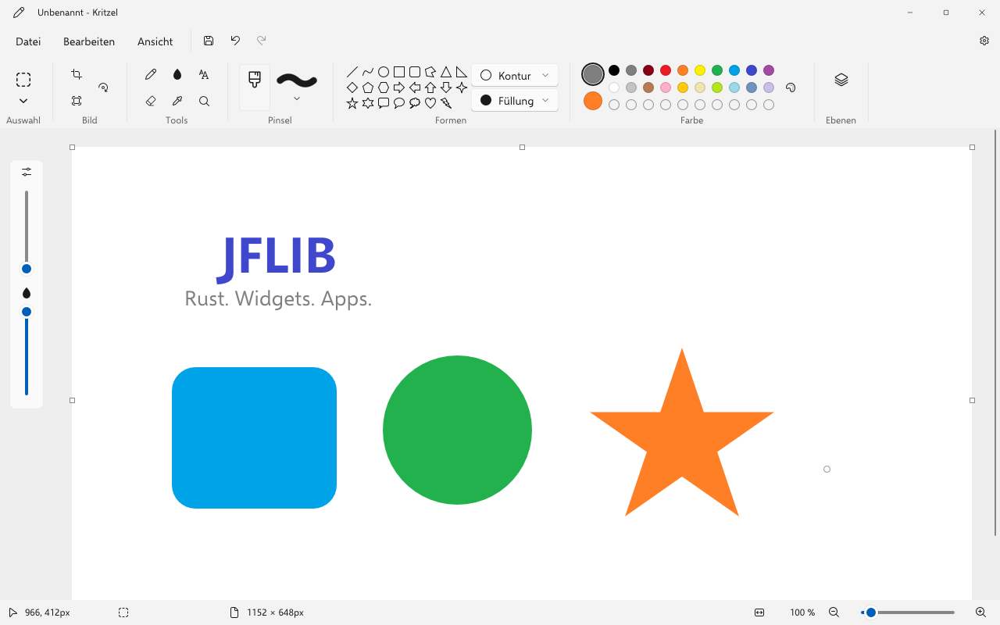</a><br>
<b><a href="https://github.com/JFLibrary/JFLib/tree/main/apps/Kritzel">Kritzel</a></b><br>
A drawing app with brushes, shapes, text, selections, and layers.<br>
<sub>Windows, Linux, Web</sub>
</td>
<td width="50%" valign="top">
<a href="https://github.com/JFLibrary/JFLib/tree/main/apps/buildManager">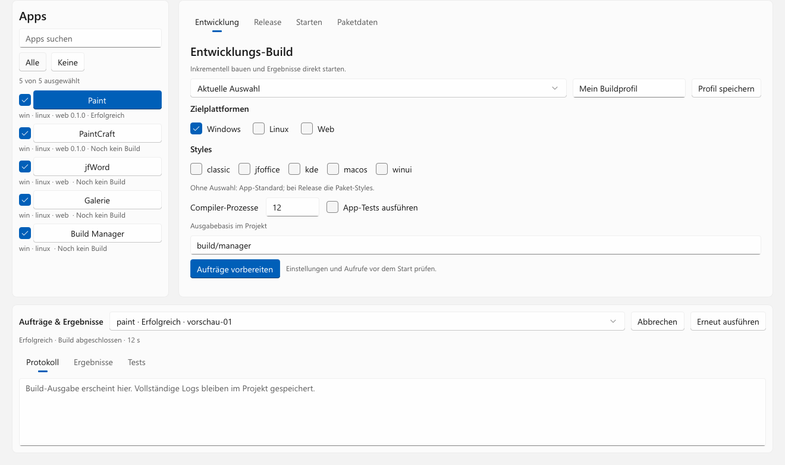</a><br>
<b><a href="https://github.com/JFLibrary/JFLib/tree/main/apps/buildManager">Build Manager</a></b><br>
A graphical build app for applications, styles, profiles, tests, and release packages.<br>
<sub>Windows, Linux</sub>
</td>
</tr>
</table>

## Repositories

| Repository | Contents |
| --- | --- |
| [JFLib](https://github.com/JFLibrary/JFLib) | The library, its styles, the apps, tests, and documentation |
| [JFPainter](https://github.com/JFLibrary/JFPainter) | The image editor, formerly PaintCraft, with its plugins and paint.net host |
| [jflibWebsite](https://github.com/JFLibrary/jflibWebsite) | The source of [jflib.org](https://jflib.org) |

## License

JFLib is dual-licensed under the MIT License or the Apache License 2.0, at your option.
JFPainter, Kritzel, and BackupCraft are released under the MIT License. Third-party code, data,
and fonts keep their own licenses. See [License](https://github.com/JFLibrary/JFLib#license) and
[Trademarks](https://github.com/JFLibrary/JFLib#trademarks) in the JFLib repository.
